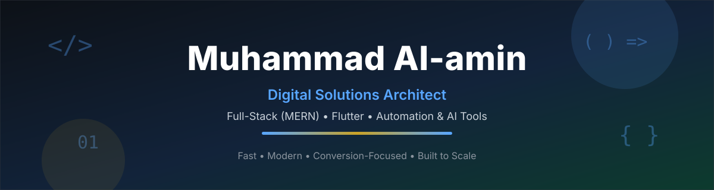

<!--
  GitHub Profile README — Muhammad Al-amin (mdalamins20)
  Animation note: GitHub strips JavaScript and <style> from READMEs, so
  animation here is done the way GitHub actually allows it: animated SVG
  (SMIL) hosted in this repo + an animated typing line. No fake stats,
  counts, ratings or testimonials are included.
-->

  

   

  

  

    I help startups and businesses build fast, modern, conversion-focused
    websites and mobile applications that scale effortlessly — bridging the
    gap between robust engineering and intuitive design.
  

  

    
    
    
    
  

## 👨‍💻 About Me

| | |
|---|---|
| 🚀 **Current Role** | Assistant IT Department Officer at **Dewan Furniture** & Freelance Developer |
| 💻 **Web Engineering** | Highly scalable, SEO-friendly ecosystems with **React.js, Node.js (MERN), Next.js, and TypeScript** |
| 📱 **Mobile Development** | Seamless cross-platform experiences with **Flutter & Dart** — e.g. *Hishabio, Smart Wallet App* |
| 🤖 **Automation & AI** | Custom desktop applications, AI automation tools (**FastAPI**), and robust scripts with **Python & C#** |
| 🎨 **Creative & UI/UX** | High-impact visual systems and cinematic video content with **Adobe Photoshop, Illustrator, and Premiere Pro** |
| 🐧 **Systems & Strategy** | **Kali Linux**, PC hardware troubleshooting, Google AppSheet, and digital growth strategy |
| 📍 **Location** | Dhaka, Bangladesh |

## 🧰 What I Build

| 🌐 Web Platforms | 📱 Mobile Apps |
|---|---|
| Conversion-focused websites, dashboards and full-stack products built on React, Next.js and Node.js — engineered for speed, SEO and scale. | Cross-platform Flutter apps with clean architecture, offline-ready data and polished, native-feeling UI. |

| 🤖 Automation & Tools | 🎨 Design & Content |
|---|---|
| Python and FastAPI automation, custom desktop tools and AI-assisted workflows that remove repetitive work. | UI/UX systems, brand creatives and video content that make a product look as good as it works. |

## 🛠️ Technical Arsenal

  
    
  
  
  
  
  
  
  
  

## 📈 GitHub Analytics

  
  

## 🚀 Featured Projects

| 🌟 Project | 📝 What it does | 🛠️ Tech Stack |
|---|---|---|
| **[Hishabio](https://mdalamin.web.app/)** | Comprehensive personal finance mobile app for daily transactions & budgets. | Flutter, SQLite, Hive |
| **[Mess-Mate & Rice Meal](https://mdalamin.web.app/)** | Highly scalable real-time mess & meal management web systems. | React, TypeScript, Firebase |
| **[Order Manager Pro](https://mdalamin.web.app/)** | Professional production order generator featuring AI data extraction. | React, TS, Gemini API, jsPDF |
| **[HandleHunt](https://mdalamin.web.app/)** | Lightning-fast application to check username availability across platforms. | Next.js, Tailwind CSS |
| **[Smart Wallet App](https://mdalamin.web.app/)** | Secure digital wallet solution engineered for global store publishing. | Flutter, Dart |
| **DigitalBazar** | Robust full-stack e-commerce platform ensuring smooth shopping experiences. | MERN Stack |

> *(Note: Many of my commercial projects, hardware-integrated systems, and SaaS platforms like EduStream are kept in private repositories.)*

## 📫 Let's Connect & Collaborate

  
  
  
  
    
  <i>Open to freelance work, collaborations and interesting product ideas — 
  if you have a project in mind, let's build it properly.</i>

 

  

